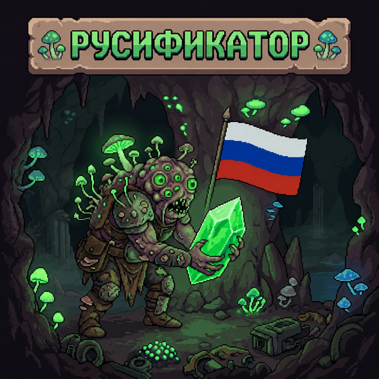

# Caves of Qud — Полный русский перевод

  

  
  
  
  
  

---

Полная русская локализация для игры **Caves of Qud**. Мод внедряется нативно через встроенную скриптовую систему игры и Harmony, не требуя сторонних утилит или замены файлов самой игры.

> [!NOTE]
> Свежие сборки и готовые архивы русификатора всегда публикуются в разделе **[GitHub Releases](https://github.com/memasevich/CoQ-ru-translate-public/releases)**.

---

## ⚡ Особенности перевода

* **Глубокая адаптация:** Полный перевод интерфейса (Modern UI и Classic UI), предметов, мутаций, кибернетики, навыков, существ, диалогов, истории султанов, книг и игрового лога.
* **Динамическая морфология:** Собственный морфологический движок (`MorphologyService`), обеспечивающий правильное склонение названий предметов, существ и фракций по падежам, родам и числам в боевых сообщениях и описаниях.
* **Встроенный автоапдейтер (v1.0.8+):** Игра автоматически уведомляет о выходе новых версий перевода на GitHub и позволяет обновиться в один клик прямо из главного меню.
* **Безопасность:** Любое обновление автоматически делает резервную копию в папку `[Документы]\CavesOfQud_Mod_Backups\`.

---

## ⌨️ Горячие клавиши в игре

| Клавиша | Назначение | Описание |
| :---: | :--- | :--- |
| **`[F10]`** | **Вкл / Выкл русификатор** | Мгновенно переключает перевод на лету прямо в игре. Удобно, если нужно сверить оригинальное английское название предмета, рецепта или термина. |
| **`[F11]`** | **Проверить обновления** | Принудительно запускает проверку новых релизов на GitHub в главном меню (при наличии обновления откроется диалог с changelog). |

---

## 🚀 Внутриигровое автообновление

Начиная с версии **1.0.8**, вам больше не нужно вручную отслеживать релизы или распаковывать архивы:
1. При запуске игры мод асинхронно проверяет [Releases репозитория](https://github.com/memasevich/CoQ-ru-translate-public/releases).
2. Если вышел новый патч перевода, в главном меню появится нативное окно:
   - Полный список изменений (**Changelog**).
   - Кнопки **«Да»** (установить) и **«Нет»** (напомнить позже).
3. При нажатии «Да» мод сам скачает свежий архив, создаст резервную копию предыдущей версии, установит обновление и тихо перезапустит игру за 2 секунды.

---

## 📦 Установка вручную (первый раз)

Если вы устанавливаете русификатор впервые или хотите обновить его вручную:

1. Перейдите на страницу **[Последнего релиза (Releases)](https://github.com/memasevich/CoQ-ru-translate-public/releases/latest)**.
2. В блоке **Assets** скачайте архив `RussianLocalization.zip`.
3. Распакуйте папку `RussianLocalization` в каталог пользовательских модов Caves of Qud:
   * **Windows:**  
     `%USERPROFILE%\AppData\LocalLow\Freehold Games\CavesOfQud\Mods\RussianLocalization`  
     *(Полный путь: `C:\Users\<ВашеИмя>\AppData\LocalLow\Freehold Games\CavesOfQud\Mods\RussianLocalization`)*
   * **macOS (Steam / CrossOver):**  
     `~/Library/Application Support/CrossOver/Bottles/<ИмяБутылки>/drive_c/users/crossover/AppData/LocalLow/Freehold Games/CavesOfQud/Mods/RussianLocalization`
4. Запустите игру.
5. Откройте **Параметры** → **Модификации** (Mod Manager) и убедитесь, что **Caves of Qud Russian Localization** включен.

---

## 🍎 Для пользователей Mac (Apple Silicon)

На процессорах Apple Silicon (M1/M2/M3/M4) официальная нативная macOS-версия Caves of Qud может не запускать Harmony-патчи. Рекомендуемые способы запуска:
* **CrossOver / Wine** — работает из коробки в режиме совместимости с Windows.
* **Rosetta 2** — запуск x86_64-версии Steam через Rosetta (`softwareupdate --install-rosetta` и флаг «Открывать с помощью Rosetta» в свойствах Steam).
* При проблемах с Harmony замените `0Harmony.dll` внутри пакета игры на `net48/0Harmony.dll` из архива [Harmony-Fat.2.4.2.0](https://github.com/pardeike/Harmony/releases).

---

## 🐛 Логи и обратная связь

Если вы нашли опечатку, непереведенный текст или столкнулись с ошибкой:
* Логи мода автоматически сохраняются в:  
  `%USERPROFILE%\Documents\CavesOfQud_RU_Logs\`
* Написать об ошибке или предложить улучшение:
  * **Telegram:** [@memasev1ch](https://t.me/memasev1ch)
  * **GitHub Issues:** [Открыть Issue](https://github.com/memasevich/CoQ-ru-translate-public/issues)

---

## ❤️ Поддержать перевод

Подробные патчноуты и новые описания обновлений выходят на Boosty. Если вам нравится русификатор, вы можете поддержать проект:
👉 **[Поддержать разработку на Boosty](https://boosty.to/memasevich/donate)**

*Всем живите и пейте!*
